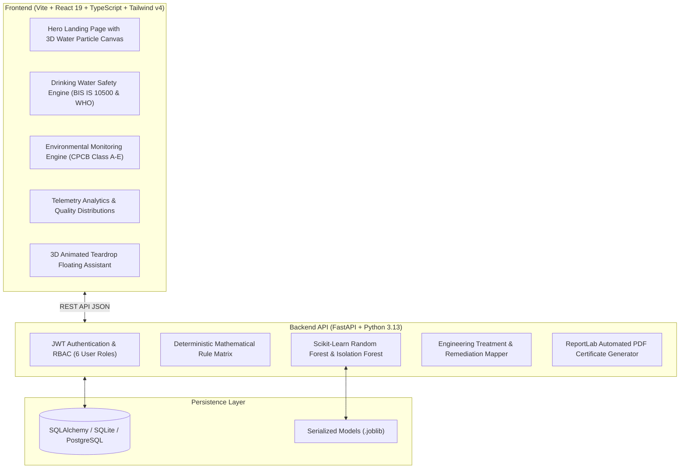

# AquaGuard AI: AI-Powered Water Quality Analysis, Drinking Water Safety & Environmental Monitoring Platform

[](https://python.org)
[](https://fastapi.tiangolo.com)
[](https://react.dev)
[](https://tailwindcss.com)
[](https://scikit-learn.org)
[](https://bis.gov.in)

AquaGuard AI is an enterprise-grade water intelligence platform engineered to serve both human consumption safety auditing and municipal environmental water stewardship.

---

## 🌊 Platform Architecture



---

## 🎯 Dual-Sector Capabilities

### Category A: Human Water Safety & Drinking Water Quality
Designed for bottled water companies (*Bisleri, Aquafina*), hospital ICU/dialysis water managers, food safety regulators, and water treatment engineers.
- **Assays 14 Critical Parameters**: pH, Turbidity, TDS, Electrical Conductivity, Total Hardness, Chlorides, Fluoride, Nitrates, Iron, Arsenic, Lead, E. coli, and Total Coliform.
- **BIS IS 10500:2012 & WHO Reference Matrix**: Immediate classification against statutory Acceptable and Permissible limits.
- **Absolute Microbial Safety Guardrail**: Zero tolerance for bacterial pathogens (*E. coli* count > 0 strictly sets potability to `False` regardless of normal physical parameters).
- **Certified PDF Export**: One-click generation of official test reports with parameter tables and accreditation disclaimers.

### Category B: Environmental Water Quality Monitoring
Designed for municipal corporations (*Delhi Jal Board*), Pollution Control Boards (*CPCB/SPCB*), and Sewage Treatment Plant (*STP/ETP*) operators.
- **Assays Ecosystem Sources**: Rivers, Lakes, Ponds, Sewage Inflow, Industrial Effluent, and Drainage.
- **CPCB Designated Best Use Criteria**: Categorizes water into Classes A through E (or *Below Class E - Heavily Polluted*).
- **Oxygen Balance & Eutrophication**: Monitors Dissolved Oxygen (DO), Biochemical Oxygen Demand (BOD), Chemical Oxygen Demand (COD), Free Ammonia, and Phosphates.
- **Wastewater Treatment Remediation**: Recommends validated engineering solutions (MBBR, Activated Sludge Process, Fine-Bubble Diffused Aeration, Heavy Metal Adsorption).

---

## 🤖 AI & Machine Learning Architecture

1. **Random Forest Potability Classifier**:
   - Algorithmic screening model trained on water quality distributions.
   - Evaluates multivariate chemical interactions.
   - Outputs class probabilities and Explainable AI (XAI) feature contribution weights.
2. **Isolation Forest Anomaly Detector**:
   - Detects multivariate outliers, chemical dumping, and industrial contamination spikes.
3. **Interactive 3D Teardrop Rule-Based Chatbot**:
   - Floating WebGL particle-rendered water droplet interface.
   - Instant offline keyword matching and domain intent recognition answering FAQs on water parameters, treatment methods, and statutory standards without external API keys.

---

## 👥 Role-Based Access Control (RBAC)

Pre-configured role profiles available via one-click demo login:
1. **Water Quality Engineer**: Full assay execution, threshold calibrations.
2. **Hospital Administrator**: Clinical dialysis and facility water audit logs.
3. **Food Safety Inspector**: Commercial restaurant and bottled plant compliance inspections.
4. **Municipal Corporation Engineer**: Urban distribution ward and intake telemetry.
5. **Environmental Researcher**: Surface river basins and lake eutrophication monitoring.
6. **System Administrator**: User governance and audit log access.

---

## 🚀 Quickstart Guide

### Option 1: One-Click Startup (Windows)
Double-click `start_aquaguard.bat` in the project root. This starts both the FastAPI backend and React frontend.

### Option 2: Manual Terminal Startup

#### 1. Backend Startup
```bash
# Install Python dependencies
pip install -r backend/requirements.txt

# Start FastAPI server
python -m uvicorn backend.app.main:app --host 0.0.0.0 --port 8000 --reload
```
* Backend API: `http://localhost:8000`
* Interactive OpenAPI Docs: `http://localhost:8000/docs`

#### 2. Frontend Startup
```bash
cd frontend
npm install
npm run dev
```
* Frontend Application: `http://localhost:5173`

---

## 🧪 Automated Test Suite

Run the comprehensive pytest suite covering Auth, Standards Engine, ML Models, ReportLab PDF, and End-to-End integration:

```bash
python -m pytest tests/ -v
```

17 automated tests passing:
- `test_auth.py`: User registration, password hashing, JWT bearer tokens, role checks.
- `test_backend_core.py`: Healthcheck, database table initialization, SQLAlchemy schemas.
- `test_standards_and_recommendations.py`: BIS IS 10500 limits, microbial fail overrides, CPCB classes.
- `test_ml_service.py`: Random Forest potability inference, Isolation Forest anomaly checks, XAI contributions.
- `test_water_api.py`: Drinking and environmental REST endpoints, telemetry statistics.
- `test_pdf_report.py`: ReportLab PDF byte generation, compliance table formatting, metadata headers.
- `test_e2e_flow.py`: Complete user journey from signup to sample analysis, ML prediction, and certificate download.

---

## ⚖️ Scientific Disclaimer

AquaGuard AI analysis results and machine-learning predictions are preliminary decision-support outputs. They do not replace certified testing by an ISO/IEC 17025 accredited laboratory. Microbiological potability requires verified bacterial culture assays. Untreated sewage or wastewater is strictly non-potable.
