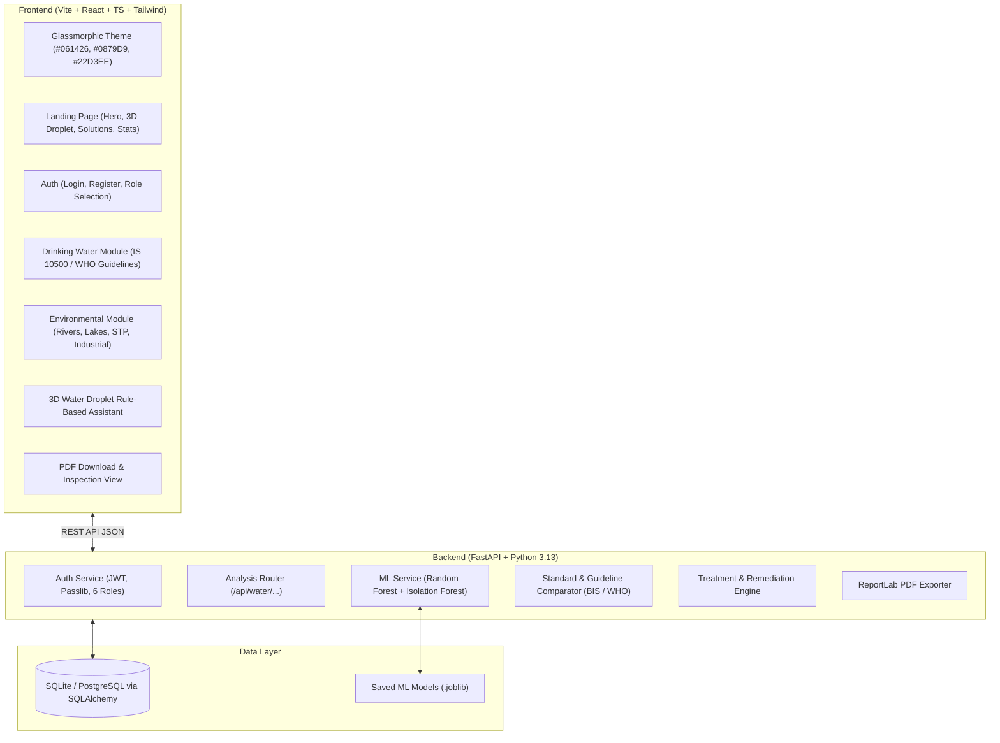

# AquaGuard AI Implementation Plan

> **For agentic workers:** REQUIRED SUB-SKILL: Use superpowers:subagent-driven-development (recommended) or superpowers:executing-plans to implement this plan task-by-task. Steps use checkbox (`- [ ]`) syntax for tracking.

**Goal:** Build and deliver **AquaGuard AI**, a full-stack water quality analysis, drinking water safety, and environmental monitoring platform with FastAPI backend, Scikit-learn ML engine, ReportLab PDF generation, React + TypeScript + Tailwind frontend, 3D animated water droplet chatbot, and role-based access control.

**Architecture:** A decoupled client-server architecture. The backend is a FastAPI application exposing RESTful endpoints for JWT authentication, drinking and environmental water sample analysis, Scikit-learn inference with explainability, rule-based treatment recommendations, and PDF generation backed by SQLite (and Postgres-ready SQLAlchemy). The frontend is a modern React + TypeScript + Vite single-page application styled in a deep ocean dark-blue glassmorphic palette (`#061426`, `#0879D9`, `#22D3EE`), featuring interactive Recharts, Three.js 3D water particle visualization, role-based dashboards, and a standalone rule-based 3D chatbot.

**Architecture Diagram:**



**Tech Stack:**
- **Backend:** Python 3.13, FastAPI, Uvicorn, SQLAlchemy 2.0, Pydantic v2, Python-Jose / PyJWT, Passlib (bcrypt), Scikit-learn, Pandas, NumPy, Joblib, ReportLab.
- **Frontend:** React 18, TypeScript, Vite, Tailwind CSS, Lucide-React, Recharts, Three.js / Canvas 3D particle rendering.
- **Database:** SQLite for zero-config local development, easily switchable to PostgreSQL via `DATABASE_URL`.

**Spec:** MASTER DEVELOPMENT PROMPT: AQUAGUARD AI

## Global Constraints
- Target palette: Background `#061426`, Secondary `#0B1F35`, Primary `#0879D9`, Cyan `#22D3EE`, Aqua `#38BDF8`, Text `#F1F5F9`, Secondary Text `#94A3B8`.
- Standards compliance: BIS IS 10500:2012 and WHO Drinking-Water Guidelines.
- Scientific disclaimers: AI predictions are screening tools only and must never claim water is certified potable without microbiological laboratory testing. Untreated sewage/wastewater must never be labeled potable.
- No external API hard dependency: The rule-based chatbot and ML inference must operate offline without mandatory external cloud keys (Gemini API is optional fallback).
- Role-based authorization: Administrator, Water Quality Engineer, Hospital Administrator, Food Safety Inspector, Municipal Engineer, Environmental Researcher.

## Review Focus
1. **Invalid parameter ranges:** Negative values for pH, TDS, or microbial counts must be rejected by Pydantic validation (e.g. pH must be between 0 and 14).
2. **False potable safety claims:** High microbial count (E. coli > 0) with otherwise normal pH/turbidity must be strictly flagged as CONTAMINATED / NOT POTABLE regardless of ML score.
3. **Sewage contamination classification:** Environmental samples with extreme BOD/COD must immediately classify as heavily polluted and mandate wastewater treatment without drinking-water comparison.
4. **Offline ML fallback:** If the ML model file is missing or corrupted, the system must seamlessly fall back to deterministic BIS/WHO rule evaluation with a warning flag rather than returning 500 error.
5. **PDF generation robustness:** Missing optional sample fields (e.g., location name, comments) must render cleanly without throwing null reference exceptions in ReportLab.

---

### Task 1: Project Scaffolding, Backend Core & Database Models

**Files:**
- Create: `backend/requirements.txt`
- Create: `backend/app/database.py`
- Create: `backend/app/models.py`
- Create: `backend/app/config.py`
- Create: `backend/app/main.py`
- Create: `.env.example`
- Create: `tests/test_backend_core.py`

**Interfaces:**
- Produces: SQLAlchemy models `User`, `WaterSample`, `AnalysisResult`, `AuditLog`.
- Produces: `get_db` FastAPI dependency and database initialization.

- [ ] **Step 1: Write tests for database models and healthcheck**
```python
# tests/test_backend_core.py
from fastapi.testclient import TestClient
from backend.app.main import app

client = TestClient(app)

def test_healthcheck():
    response = client.get("/health")
    assert response.status_code == 200
    assert response.json()["status"] == "healthy"
```

- [ ] **Step 2: Run test to verify it fails**
Run: `python -m pytest tests/test_backend_core.py`
Expected: FAIL (module not found)

- [ ] **Step 3: Implement `backend/requirements.txt`, `config.py`, `database.py`, `models.py`, and `main.py`**
Install dependencies: `fastapi`, `uvicorn`, `sqlalchemy`, `pydantic`, `pydantic-settings`, `python-jose`, `passlib[bcrypt]`, `scikit-learn`, `pandas`, `numpy`, `joblib`, `reportlab`, `pytest`, `httpx`.
Implement SQLAlchemy declarative base with SQLite/Postgres support, tables for users, roles, water samples (drinking and environmental columns), and analysis history.

- [ ] **Step 4: Run test to verify it passes**
Run: `python -m pytest tests/test_backend_core.py`
Expected: PASS

- [ ] **Step 5: Verify models and migrations initialization**
Run: `python -c "from backend.app.database import init_db; init_db()"`

---

### Task 2: Authentication and Role-Based Authorization API

**Files:**
- Create: `backend/app/authentication/auth.py`
- Create: `backend/app/schemas/auth_schemas.py`
- Create: `backend/app/api/auth_routes.py`
- Modify: `backend/app/main.py`
- Create: `tests/test_auth.py`

**Interfaces:**
- Consumes: `User` model, `get_db` from Task 1.
- Produces: `POST /api/auth/register`, `POST /api/auth/login`, `GET /api/auth/me`.
- Roles supported: `admin`, `water_quality_engineer`, `hospital_admin`, `food_safety_inspector`, `municipal_engineer`, `environmental_researcher`.

- [ ] **Step 1: Write tests for user registration, login, and role authorization**
```python
# tests/test_auth.py
def test_register_and_login(client):
    # Register Water Quality Engineer
    res = client.post("/api/auth/register", json={
        "email": "engineer@aquaguard.io",
        "password": "Password123!",
        "full_name": "Dr. Ananya Sharma",
        "role": "water_quality_engineer",
        "organization": "Delhi Jal Board"
    })
    assert res.status_code == 201
    
    # Login
    login_res = client.post("/api/auth/login", data={
        "username": "engineer@aquaguard.io",
        "password": "Password123!"
    })
    assert login_res.status_code == 200
    assert "access_token" in login_res.json()
```

- [ ] **Step 2: Run test to verify it fails**
Run: `python -m pytest tests/test_auth.py`
Expected: FAIL

- [ ] **Step 3: Implement Auth Service and API Routes**
Use bcrypt for password hashing and JWT for Bearer token generation. Implement role verification dependencies (`get_current_user`, `require_roles(...)`).

- [ ] **Step 4: Run test to verify it passes**
Run: `python -m pytest tests/test_auth.py`
Expected: PASS

---

### Task 3: Standards Engine & Treatment Recommendation Service

**Files:**
- Create: `backend/app/services/standards.py`
- Create: `backend/app/services/recommendations.py`
- Create: `backend/app/schemas/water_schemas.py`
- Create: `tests/test_standards_and_recommendations.py`

**Interfaces:**
- Produces: `evaluate_drinking_water(params: DrinkingWaterParams) -> EvaluationResult`
- Produces: `evaluate_environmental_water(params: EnvironmentalWaterParams) -> EvaluationResult`
- Produces: `recommend_treatments(issues: list[DetectedIssue], source: str) -> list[TreatmentRecommendation]`

- [ ] **Step 1: Write tests for BIS IS 10500, WHO guidelines, and treatment recommendations**
```python
# tests/test_standards_and_recommendations.py
def test_drinking_water_evaluation_with_microbial_fail():
    # pH normal (7.2), Turbidity normal (1 NTU), but E. coli = 5 CFU/100ml
    res = evaluate_drinking_water({"ph": 7.2, "turbidity": 1.0, "e_coli": 5.0})
    assert res.potable is False
    assert "E. coli detected" in [issue.parameter for issue in res.violations]
    assert any("Disinfection" in rec.title for rec in res.recommendations)
```

- [ ] **Step 2: Run test to verify it fails**
Run: `python -m pytest tests/test_standards_and_recommendations.py`
Expected: FAIL

- [ ] **Step 3: Implement BIS IS 10500:2012 / WHO standards tables & recommendation engine**
Implement acceptable and permissible limits for pH (6.5-8.5), Turbidity (<=1-5 NTU), TDS (<=500-2000 mg/L), Hardness (<=200-600 mg/L), Chlorides (<=250-1000 mg/L), Fluoride (<=1.0-1.5 mg/L), Nitrate (<=45 mg/L), Iron (<=1.0 mg/L), Arsenic (<=0.01 mg/L), Lead (<=0.01 mg/L), E. coli (0), and Total Coliform (0).
Implement environmental guidelines for CPCB Class A-E water criteria (DO >= 4-6 mg/L, BOD <= 2-3 mg/L, COD <= 250 mg/L, Free Ammonia, Phosphates).
Map issues to water treatment technologies:
- High turbidity -> Coagulation/Flocculation, Multi-Media Filtration
- High TDS/Conductivity -> Reverse Osmosis (RO) / Nanofiltration
- High Hardness -> Ion Exchange Water Softening
- Microbial Contamination -> UV Irradiation, Ozonation, Chlorination
- Heavy Metals (Arsenic, Lead, Iron) -> Activated Alumina, Greensand Iron Filter, Heavy Metal Chelation / Membrane Separation.

- [ ] **Step 4: Run test to verify it passes**
Run: `python -m pytest tests/test_standards_and_recommendations.py`
Expected: PASS

---

### Task 4: Machine Learning Engine (Classification & Anomaly Detection)

**Files:**
- Create: `backend/ml/datasets/synthetic_dataset_generator.py`
- Create: `backend/ml/training/train_models.py`
- Create: `backend/app/services/ml_service.py`
- Create: `tests/test_ml_service.py`

**Interfaces:**
- Produces: `trained_models/drinking_water_rf.joblib`, `trained_models/anomaly_detector.joblib`
- Produces: `MLService.predict_drinking_potability(features: dict) -> MLPredictionResult`
- Produces: `MLService.detect_anomalies(features: dict) -> AnomalyResult`

- [ ] **Step 1: Write tests for ML service inference and anomaly score**
```python
# tests/test_ml_service.py
def test_ml_prediction_and_explainability():
    service = MLService()
    sample = {"ph": 7.4, "turbidity": 2.1, "tds": 320, "hardness": 150, "conductivity": 410, "chlorides": 85, "nitrate": 12}
    result = service.predict_drinking_potability(sample)
    assert result.status in ["Within configured limits", "Requires further investigation", "Treatment required", "Potential contamination detected"]
    assert len(result.feature_importance) > 0
    assert 0.0 <= result.confidence <= 1.0
```

- [ ] **Step 2: Run test to verify it fails**
Run: `python -m pytest tests/test_ml_service.py`
Expected: FAIL

- [ ] **Step 3: Implement data generation, Scikit-learn training pipeline, and ML Service**
Create realistic dataset generation grounded in BIS/WHO distributions and public water quality standards with labeled potability and anomaly markers.
Train Random Forest Classifier with cross-validation and Isolation Forest for anomaly detection.
Save models and scalers into `backend/ml/models/`.
Implement Explainable AI breakdown returning per-parameter contribution and confidence scores.

- [ ] **Step 4: Run model training and verify test passes**
Run: `python -m backend.ml.training.train_models`
Run: `python -m pytest tests/test_ml_service.py`
Expected: PASS

---

### Task 5: Water Quality Analysis API & Historical Records

**Files:**
- Create: `backend/app/api/water_routes.py`
- Create: `backend/app/api/dashboard_routes.py`
- Modify: `backend/app/main.py`
- Create: `tests/test_water_api.py`

**Interfaces:**
- Produces: `POST /api/water/drinking/analyze`
- Produces: `POST /api/water/environmental/analyze`
- Produces: `GET /api/water/history`
- Produces: `GET /api/water/sample/{id}`
- Produces: `GET /api/dashboard/stats`
- Produces: `GET /api/water/standards`

- [ ] **Step 1: Write tests for drinking and environmental analysis endpoints**
```python
# tests/test_water_api.py
def test_drinking_analyze_api(client, auth_headers):
    payload = {
        "source_name": "Municipal Ward 4 Inflow",
        "location": "New Delhi, Sector 12",
        "parameters": {
            "ph": 7.2, "turbidity": 1.5, "tds": 350.0, "hardness": 180.0,
            "chloride": 120.0, "nitrate": 15.0, "e_coli": 0.0
        }
    }
    res = client.post("/api/water/drinking/analyze", json=payload, headers=auth_headers)
    assert res.status_code == 200
    data = res.json()
    assert "sample_id" in data
    assert "assessment" in data
    assert "ml_prediction" in data
    assert "treatment_recommendations" in data
```

- [ ] **Step 2: Run test to verify it fails**
Run: `python -m pytest tests/test_water_api.py`
Expected: FAIL

- [ ] **Step 3: Implement Water & Dashboard API Endpoints**
Wire `standards.py`, `ml_service.py`, `recommendations.py`, and database persistence.
Implement summary statistics (total samples analyzed, drinking vs. environmental, compliance rate, anomalies flagged) for the dashboard.

- [ ] **Step 4: Run test to verify it passes**
Run: `python -m pytest tests/test_water_api.py`
Expected: PASS

---

### Task 6: PDF Report Generation Service

**Files:**
- Create: `backend/app/services/pdf_generator.py`
- Create: `backend/app/api/report_routes.py`
- Modify: `backend/app/main.py`
- Create: `tests/test_pdf_report.py`

**Interfaces:**
- Produces: `generate_water_quality_pdf(sample_record, analysis_result) -> bytes`
- Produces: `GET /api/water/reports/{sample_id}/pdf`

- [ ] **Step 1: Write test for PDF generation endpoint**
```python
# tests/test_pdf_report.py
def test_pdf_generation(client, auth_headers, sample_id):
    res = client.get(f"/api/water/reports/{sample_id}/pdf", headers=auth_headers)
    assert res.status_code == 200
    assert res.headers["content-type"] == "application/pdf"
    assert res.content.startswith(b"%PDF")
```

- [ ] **Step 2: Run test to verify it fails**
Run: `python -m pytest tests/test_pdf_report.py`
Expected: FAIL

- [ ] **Step 3: Implement ReportLab PDF Builder**
Create a professional report with:
- Header: AquaGuard AI official logo and report ID.
- Metadata table: Sample ID, date, location, category (Drinking / Environmental), inspector name & role.
- Measured Parameters table with columns: Parameter, Measured Value, Acceptable Limit, Permissible Limit, Compliance Status.
- AI & Statistical Classification section.
- Recommended Engineering Treatments.
- Prominent Laboratory Accreditation & Regulatory Disclaimer.

- [ ] **Step 4: Run test to verify it passes**
Run: `python -m pytest tests/test_pdf_report.py`
Expected: PASS

---

### Task 7: Frontend Scaffolding, Theme & Navigation

**Files:**
- Create: `frontend/package.json`
- Create: `frontend/vite.config.ts`
- Create: `frontend/tailwind.config.js`
- Create: `frontend/src/index.css`
- Create: `frontend/src/types/index.ts`
- Create: `frontend/src/services/api.ts`
- Create: `frontend/src/components/Navbar.tsx`
- Create: `frontend/src/components/Footer.tsx`
- Create: `frontend/src/App.tsx`

**Interfaces:**
- Produces: Vite + React 18 + Tailwind setup with glassmorphic ocean theme.
- Produces: Responsive navigation with links to Home, Solutions, Technology, How It Works, Dashboards, and Auth.

- [ ] **Step 1: Initialize Vite React TypeScript project and install frontend dependencies**
Install: `tailwindcss`, `postcss`, `autoprefixer`, `lucide-react`, `recharts`, `three`, `@types/three`, `axios`.
Configure Tailwind colors `#061426`, `#0B1F35`, `#0879D9`, `#22D3EE`, `#38BDF8`.

- [ ] **Step 2: Build Navbar and Footer components**
Implement sticky glassmorphic navigation with logo, mobile drawer, active section highlighting, and login/dashboard state buttons.

- [ ] **Step 3: Verify frontend build compiles cleanly**
Run: `cd frontend && npm run build`
Expected: PASS (generates `dist/`)

---

### Task 8: Futuristic Landing Page with 3D Water Droplet Canvas

**Files:**
- Create: `frontend/src/components/ThreeWaterDroplet.tsx`
- Create: `frontend/src/components/HeroSection.tsx`
- Create: `frontend/src/components/SolutionsSection.tsx`
- Create: `frontend/src/components/HowItWorksSection.tsx`
- Create: `frontend/src/components/TechArchitectureSection.tsx`
- Create: `frontend/src/components/LiveStatsSection.tsx`
- Create: `frontend/src/components/CallToAction.tsx`
- Create: `frontend/src/pages/LandingPage.tsx`
- Modify: `frontend/src/App.tsx`

**Interfaces:**
- Produces: High-performance 3D particle water droplet visualization in Three.js with glowing blue particles and fluid wave movement.
- Produces: Complete landing page matching Section 6 of the master spec.

- [ ] **Step 1: Implement 3D Water Droplet Canvas using Three.js**
Create sphere particle mesh with custom vertex shaders or point cloud simulation with subtle pulsation and cyan/aqua glow.

- [ ] **Step 2: Implement Landing Page sections with interactive feature cards**
Build Hero with headline *"Smarter Water Intelligence. A Safer Tomorrow."*, feature cards for Human Water Safety & Environmental Water Intelligence, 4-step workflow, and real-time backend stats.

- [ ] **Step 3: Verify landing page renders and compiles**
Run: `cd frontend && npm run build`
Expected: PASS

---

### Task 9: Role-Based Dashboards & Water Analysis Modules

**Files:**
- Create: `frontend/src/components/AuthModal.tsx`
- Create: `frontend/src/pages/DashboardOverview.tsx`
- Create: `frontend/src/pages/DrinkingWaterModule.tsx`
- Create: `frontend/src/pages/EnvironmentalWaterModule.tsx`
- Create: `frontend/src/pages/HistoryAndReports.tsx`
- Create: `frontend/src/components/ParameterInputForm.tsx`
- Create: `frontend/src/components/AnalysisResultsCard.tsx`
- Create: `frontend/src/components/TreatmentRecCard.tsx`
- Modify: `frontend/src/App.tsx`

**Interfaces:**
- Produces: Interactive forms for Drinking Water (pH, Turbidity, TDS, Hardness, Chlorides, Fluoride, Nitrate, Heavy Metals, E. coli, Coliform).
- Produces: Interactive forms for Environmental Water (BOD, COD, DO, Conductivity, Phosphates, Ammonia, etc.).
- Produces: Interactive Recharts comparing measured values against BIS / WHO limits.
- Produces: Sample comparison and PDF download trigger.

- [ ] **Step 1: Implement AuthModal with role selector and token management**
Allow instant login or registration with pre-configured quick demo roles (e.g. Water Quality Engineer, Municipal Engineer, Hospital Admin).

- [ ] **Step 2: Build Drinking Water Analysis Module**
Include sample preset buttons (e.g. "Pure Spring Water", "Municipal Tap Water", "Borewell High TDS", "Contaminated Well Water") for instant realistic demonstration.
Render parameter comparison bars, compliance badges, ML confidence gauge, and treatment recommendations.

- [ ] **Step 3: Build Environmental Water Monitoring Module**
Support Rivers, Lakes, Ponds, Sewage, Industrial Effluent, and Drainage.
Display pollution index, CPCB water classification (Class A through E), anomaly status, and wastewater remediation techniques.

- [ ] **Step 4: Build History & PDF Export view**
Table of past samples with filter by category/location, expandable details, and one-click PDF download calling the backend `/api/water/reports/{id}/pdf`.

- [ ] **Step 5: Verify build compiles cleanly**
Run: `cd frontend && npm run build`
Expected: PASS

---

### Task 10: 3D Water Droplet Floating Chatbot

**Files:**
- Create: `frontend/src/chatbot/ChatbotDroplet3D.tsx`
- Create: `frontend/src/chatbot/knowledgeBase.ts`
- Create: `frontend/src/chatbot/ChatbotWidget.tsx`
- Modify: `frontend/src/App.tsx`

**Interfaces:**
- Produces: Floating 3D droplet button in lower right corner.
- Produces: Dark blue glassmorphic chat drawer with animated typing indicator.
- Produces: Offline rule-based intent and keyword matcher answering the 10 domain questions + suggested question chips.

- [ ] **Step 1: Implement knowledgeBase.ts with intents and FAQs**
Provide verified answers for: What is AquaGuard AI, How does analysis work, Drinking water guidelines, Environmental water monitoring, TDS explanation, pH, Turbidity, Water filtration options, Sewage treatment, PDF reports.

- [ ] **Step 2: Build ChatbotWidget with mini 3D animated canvas icon and chat UI**
Floating avatar button, conversation history state, suggested quick-query pills, user message bubble, bot message bubble, and fallback handling.

- [ ] **Step 3: Verify chatbot interaction and frontend build**
Run: `cd frontend && npm run build`
Expected: PASS

---

### Task 11: End-to-End Integration, Verification & Documentation

**Files:**
- Create: `README.md`
- Create: `docker-compose.yml`
- Create: `start_aquaguard.bat`
- Create: `start_aquaguard.sh`
- Create: `tests/test_e2e_flow.py`

**Interfaces:**
- Produces: End-to-end integration test verifying register -> submit sample -> ML predict -> PDF generate -> fetch history.
- Produces: Complete setup instructions, architecture documentation, and one-click start script.

- [ ] **Step 1: Run comprehensive backend tests**
Run: `python -m pytest tests/`
Expected: All tests PASS

- [ ] **Step 2: Build and verify frontend production bundle**
Run: `cd frontend && npm run build`
Expected: Clean build without errors

- [ ] **Step 3: Document deployment and quickstart in README.md**
Include system architecture, environment variable guide, default demo credentials, API reference, and scientific disclaimers.
